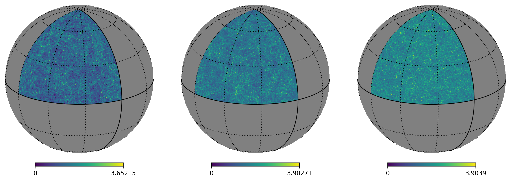

# pollux

[](https://lsstdesc-pollux.readthedocs.io/en/latest/)
[](LICENSE)
[](https://www.python.org/)
[](https://github.com/LSSTDESC/pollux/issues)
[](https://arxiv.org/abs/2605.00821)
[](https://arxiv.org/abs/2605.00818)

DESC package to create weak lensing and large-scale structure simulations from N-body simulations for the Higher-Order Statistics Topical Team.

## Features
- Interfaces with [HACC](https://cosmology.alcf.anl.gov/) and [SLICS](https://arxiv.org/abs/1805.04511) N-body simulations.
- Construction of particle and halo lightcones with replicated boxes and random isometries (translations, rotations and flips), typically identical for groups of shells of width given by the box size.
- Lensing in the Born approximation (`BornLensingBuilder`), including tomography from user-defined redshift tomographic distributions, with shear and tidal fields from spherical harmonics.
- Baryonification of the shells with [BaryonForge](https://github.com/DhayaaAnbajagane/BaryonForge) (`BaryonifiedShellBuilder`), with the matching correction of the matter power spectrum.
- Generation of tomographic galaxy catalogs using uniform sampling (`CatalogSourceUniform`) or clustered sampling via (linearly biased) sampling of the density field with Multinomial (`CatalogSourceClusteredMultinomial`, fixed total number of galaxies) or Poisson (`CatalogSourceClusteredPoisson`, fixed density) samplings.
- Intrinsic alignments, reduced shear and observed shapes in the catalogs.
- Catalog statistics (Cls and 2pt functions) and theory predictions.
- Efficient parallel computation using the [Parsl](https://parsl.readthedocs.io/en/stable/index.html) framework to distribute tasks over computing resources (`pollux.pipeline`).
- Use of DESC tools: [CCL](https://github.com/LSSTDESC/CCL), [healsparse](https://github.com/LSSTDESC/healsparse) and [NaMaster](https://github.com/LSSTDESC/NaMaster).

## Organisation of the code
- `reader.py` implements `Reader` objects to read particle data from N-body simulation snapshots, and provides basic lightcone information (particle density, shell binning, etc.)
- `map_builder.py` implements `MapBuilder` abstract objects with their basic functionalities: I/O, spherical harmonic transforms, visualization.
- `shells.py` implements `ShellBuilder` objects (subclass of `MapBuilder`) to generate particle and halo lightcone shells.
- `lensing.py` implements `LensingBuilder` objects (subclass of `MapBuilder`) to generate lensing maps from lightcone shells. 
- `baryons.py` implements `BaryonifiedShellBuilder` (subclass of `ShellBuilder`) to baryonify shells.
- `catalog.py` implements `CatalogSourceGenerator` objects to generate tomographic galaxy catalogs from the lightcone shells and lensing maps, and to measure and predict their statistics.
- `ia.py` implements catalog augmentors for intrinsic alignments and observed shapes.
- `cosmo.py` contains fixed cosmologies, and the `Tracer` and `Theory` objects for predictions.
- `plotting.py` plots two-point statistics against theory.
- `io/` handles the products on disk, with light dependencies only: their organisation (`layout.py`: directories, file names, intermediate files and the `config.yaml` of each product), the code version of runs (`code_version.py`), their index (`index.py`, `python -m pollux.io.index ROOT`) and `PolluxLoader` to read them (`loader.py`).
- `utils/` contains helper functions by theme: numerics, sky (coordinates, maps of points, masks) and NaMaster binnings.
- `pipeline/` contains the Parsl tasks and execution configuration, see the documentation.

## Installation
pollux needs Python 3.10 or later and CCL, healpy, healsparse, NaMaster, TreeCorr, sacc, numba, fitsio, skyproj, parallel_sort and pynverse, plus Parsl to run the pipeline, [BaryonForge](https://github.com/DhayaaAnbajagane/BaryonForge) for baryonification, and the `pygio` Python bindings of [GenericIO](https://git.cels.anl.gov/hacc/genericio) to read HACC files.

Then install pollux from a clone of this repository:
```
pip install -e .
```

## Running the pipeline
A run is a Python script chaining the Parsl tasks of `pollux.pipeline.tasks` with a YAML configuration, on Slurm jobs set by `pollux.pipeline.config`. See the [documentation](https://lsstdesc-pollux.readthedocs.io/) and its [pipeline page](docs/pipeline.rst) for the steps, the options and the structure of the outputs.

Each run records its code and environment in `code_version/` in its output directory, and catalogs store the git commit in their FITS headers.

## Contributing
See [CONTRIBUTING.md](CONTRIBUTING.md) for the conventions of the code (formatting, docstrings, naming, organisation, plots and pipeline tasks), and [ROADMAP.md](ROADMAP.md) for planned developments.

## License
pollux is distributed under the BSD 3-Clause License, see [LICENSE](LICENSE).

## Papers
- [Mena-Fernández et al. (2026)](https://arxiv.org/abs/2605.00821): optimization of weak lensing lightcone simulations for higher-order statistics in LSST, using lightcones created from HACC simulations with pollux.
- [Bera et al. (2026)](https://arxiv.org/abs/2605.00818): impact of baryonic feedback on two- and three-point correlation functions of galaxies and shear, from these same lightcones baryonified.


