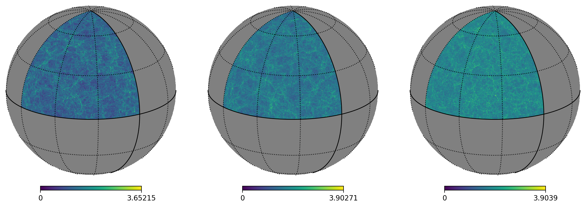

# pollux

[](https://lsstdesc-pollux.readthedocs.io/en/latest/)
[](LICENSE)
[](https://www.python.org/)
[](https://github.com/LSSTDESC/pollux/issues)
[](https://arxiv.org/abs/2605.00821)
[](https://arxiv.org/abs/2605.00818)

DESC package to create weak lensing and large-scale structure simulations from N-body simulations for the Higher-Order Statistics Topical Team.

## Features
- Interfaces with [HACC](https://cosmology.alcf.anl.gov/) and [SLICS](https://arxiv.org/abs/1805.04511) N-body simulations.
- Construction of particle and halo lightcones with replicated boxes and random isometries (translations, rotations and flips), typically identical for groups of shells of width given by the box size, on the full sky or any footprint (optionally padded and apodized for harmonic transforms).
- Three ways of building the shells from particles: from the snapshot of each shell, replicated over the shell (`SnapshotShellBuilder`), by slicing the lightcone outputs of the simulation (`LightconeShellBuilder`), or by interpolating the particle trajectories between consecutive snapshots to where they cross the lightcone (`SnapshotInterpShellBuilder`).
- Lensing in the Born approximation (`BornLensingBuilder`), including tomography from user-defined redshift distributions, with shear and tidal fields from spherical harmonics.
- Baryonification of the shells with [BaryonForge](https://github.com/DhayaaAnbajagane/BaryonForge) (`BaryonifiedShellBuilder`), with the matching correction of the matter power spectrum.
- Generation of tomographic galaxy catalogs using uniform sampling (`CatalogUniform`) or clustered sampling via (linearly biased) sampling of the density field with Multinomial (`CatalogClusteredMultinomial`, fixed total number of galaxies) or Poisson (`CatalogClusteredPoisson`, fixed density) samplings, with an optional Gaussian smoothing of the density chosen per shell.
- Intrinsic alignments, reduced shear and observed shapes in the catalogs.
- Catalog statistics (Cls with NaMaster, 2pt functions with TreeCorr, including those of the intrinsic alignments) and theory predictions with CCL.
- Efficient parallel computation using the [Parsl](https://parsl.readthedocs.io/en/stable/index.html) framework to distribute tasks over computing resources (`pollux.pipeline`), with a record of the code and environment of each run.
- Use of DESC tools: [CCL](https://github.com/LSSTDESC/CCL), [healsparse](https://github.com/LSSTDESC/healsparse) and [NaMaster](https://github.com/LSSTDESC/NaMaster).

## Organisation of the code
- `reader.py` implements `Reader` objects to read particle data from N-body simulation snapshots, and provides basic lightcone information (particle density, shell binning, etc.)
- `map_builder.py` implements `MapBuilder` abstract objects with their basic functionalities: I/O, footprints, spherical harmonic transforms, visualization.
- `shells.py` implements `ShellBuilder` objects (subclass of `MapBuilder`) to generate particle and halo lightcone shells.
- `lensing.py` implements `LensingBuilder` objects (subclass of `MapBuilder`) to generate lensing maps from lightcone shells. 
- `baryons.py` implements `BaryonifiedShellBuilder` (subclass of `ShellBuilder`) to baryonify shells.
- `catalog.py` implements `CatalogGenerator` objects to generate tomographic galaxy catalogs from the lightcone shells and lensing maps.
- `statistics/` measures and predicts the statistics of the maps (`maps.py`, `MapStatistics`) and catalogs (`catalogs.py`, `CatalogStatistics`): mixins inherited by `MapBuilder` and `CatalogGenerator`, with their plots against theory (`plotting.py`).
- `ia.py` implements the catalog augmentor of intrinsic alignments (`CatalogAugmentorIA`); the observed shapes (`CatalogAugmentorShear`) are in `catalog.py`.
- `cosmo.py` contains fixed cosmologies, and the `Tracer` and `Theory` objects for predictions.
- `io/` handles the products on disk, without the dependencies of the builders (numpy, healpy, healsparse, pyccl, sacc, astropy and PyYAML, but not NaMaster, TreeCorr, BaryonForge or Parsl): their organisation (`layout.py`: directories, file names, intermediate files and the `config.yaml` of each product), the code version of runs (`code_version.py`), their index (`index.py`, `python -m pollux.io.index ROOT`) and `PolluxLoader` to read them (`loader.py`).
- `utils/` contains helper functions by theme: numerics, sky (coordinates, maps of points, masks), NaMaster binnings and FITS tables.
- `pipeline/` contains the Parsl tasks and execution configuration, see the documentation.

## Installation
pollux needs Python 3.10 or later and CCL, healpy, healsparse, NaMaster, TreeCorr, sacc, numba, fitsio, skyproj, parallel_sort and pynverse, plus Parsl to run the pipeline, [BaryonForge](https://github.com/DhayaaAnbajagane/BaryonForge) for baryonification, and the `pygio` Python bindings of [GenericIO](https://git.cels.anl.gov/hacc/genericio) to read HACC files.

Then install pollux from a clone of this repository:
```
pip install -e .
```

## Running the pipeline
A run is a Python script chaining the Parsl tasks of `pollux.pipeline.tasks` with a YAML configuration, on Slurm jobs set by `pollux.pipeline.config`. The [documentation](https://lsstdesc-pollux.readthedocs.io/) describes each step and its options, how to use them from Python or in a run, and the outputs; the notebooks of `notebooks/` show examples.

Each run records its code and environment in `code_version/` in its output directory, and catalogs store the git commit in their FITS headers.

## Contributing
See [CONTRIBUTING.md](CONTRIBUTING.md) for the conventions of the code (formatting, docstrings, naming, organisation, plots and pipeline tasks), and [ROADMAP.md](ROADMAP.md) for planned developments.

## License
pollux is distributed under the BSD 3-Clause License, see [LICENSE](LICENSE).

## Papers
- [Mena-Fernández et al. (2026)](https://arxiv.org/abs/2605.00821): optimization of weak lensing lightcone simulations for higher-order statistics in LSST, using lightcones created from HACC simulations with pollux.
- [Bera et al. (2026)](https://arxiv.org/abs/2605.00818): impact of baryonic feedback on two- and three-point correlation functions of galaxies and shear, from these same lightcones baryonified.


