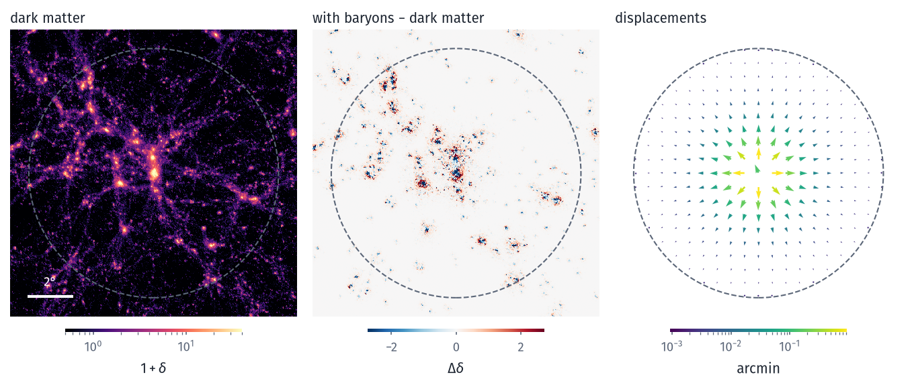

Baryons
=======

:class:`~pollux.baryons.BaryonifiedShellBuilder` applies a baryonification model of
`BaryonForge <https://github.com/DhayaaAnbajagane/BaryonForge>`_ to the shells: matter is displaced around each
halo so that its profile goes from dark matter only to that of dark matter, gas and stars. The result is a shell
builder like the others: lensing and catalogs use it in place of the dark-matter-only shells.

Inputs
------

- the dark-matter-only shell builder, whose maps are displaced, and whose options (isometries, footprint, ...) are
  kept;
- a halo builder giving the halos of each shell: a :class:`~pollux.shells.SnapshotShellBuilder` with a
  :class:`~pollux.reader.HACCHaloReader` and the same options, whose ``construct_catalogs`` writes one halo catalog
  per shell;
- the dark-matter-only and baryonified halo profiles, e.g. those of Schneider et al. (2019) from
  :func:`~pollux.baryons.s19_profiles`, or the simpler ones of Mead et al. (2020, HMcode) from
  :func:`~pollux.baryons.mead20_profiles`, set by a single AGN temperature (``log10_T_AGN``), and the halo mass definition and column (``mass_def``, ``mass_name``,
  ``mass_unit``).

Halos lighter than ``M_min`` (by default 10 particles) are left unchanged. The profiles are convolved with the
HEALPix pixel, since the displacement is applied to the shell maps.

Displacement
------------

Each halo moves the pixels within ``epsilon_max`` times its radius (default 20) by the displacement of the profiles,
and the mass of each moved pixel goes to the four pixels around its new position, as in BaryonForge's
``BaryonifyShell`` runner. The halos of a shell are processed in parallel by ``nworkers`` processes (an option of
the builder, and of the ``baryon`` section of the run configurations; 1 by default), so that shells can be
baryonified at nside 8192.

   Baryonification around a massive halo: the dark matter, the change of density, and the displacements (lengths on a log scale) within ``epsilon_max`` halo radii (dashed).

Matter power spectrum
---------------------

Predictions for baryonified products use the nonlinear matter power spectrum multiplied by the halo-model boost
``P_dmb / P_dmo`` of the same profiles, with the same mass cut
(:meth:`~pollux.baryons.BaryonifiedShellBuilder.matter_power_spectrum`). Every builder and catalog made from the
baryonified shells uses it.

Outputs
-------

The baryonified shells, and all products made from them, go to ``dmb/{tag}/`` next to the dark-matter-only
products in ``dmo/`` (see :doc:`outputs`), with the parameters of the profiles in their ``config.yaml``
(``profile_parameters``), so that shells of different models are not mixed.
