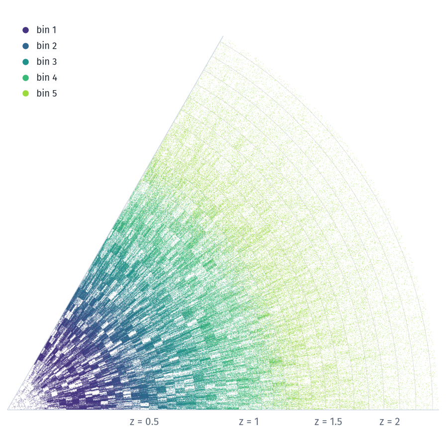
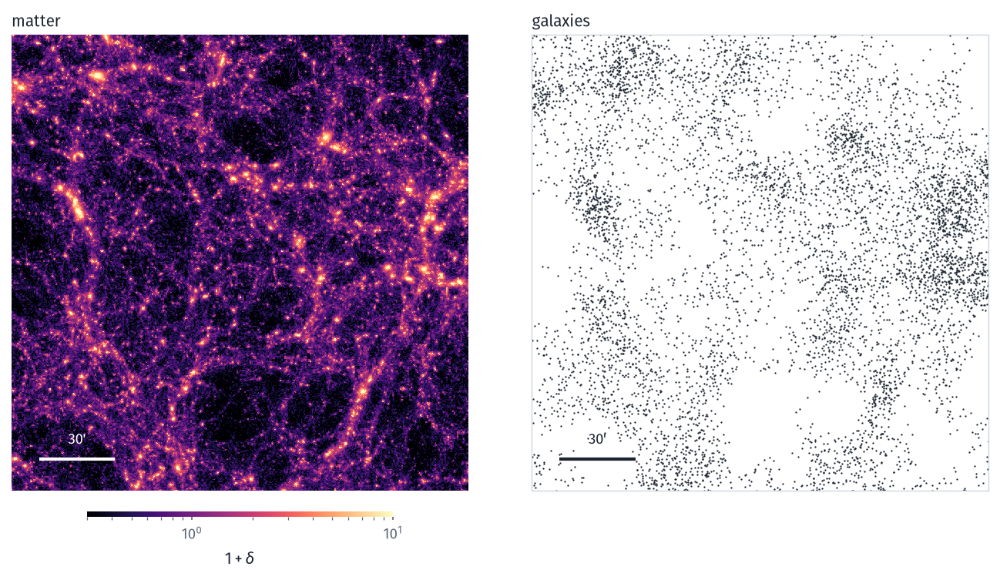
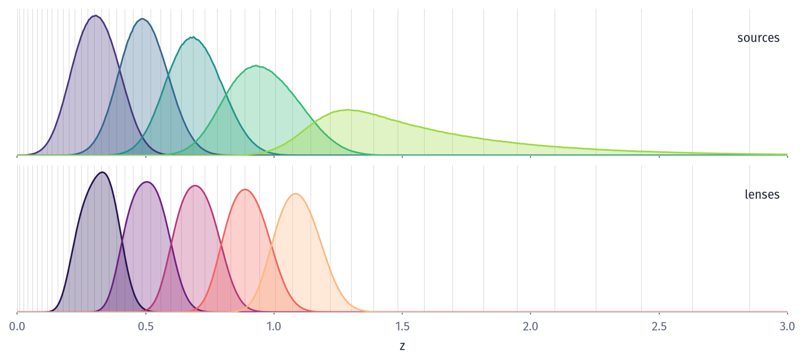

Catalogs
========

Catalog generators (:mod:`pollux.catalog`) draw tomographic source catalogs from the shells and lensing maps: for
each tomographic bin of a lensing builder, galaxies get a redshift, a position, the fields interpolated there, and
the columns added by augmentors (intrinsic alignments, observed shapes). Each bin is saved as an HDF5 catalog
``cat_bin{i}.hdf5``, readable by TXPipe (below), or as a FITS table ``cat_bin{i}.fits`` with
``catalog_format='fits'``.

   The galaxies of the five source bins of HACC150_3 in a thin slice through the equator, over the shells (grey).

Sampling
--------

Redshifts are drawn from the redshift distribution of the bin, which assigns each galaxy to a shell. Positions are
then drawn by one of:

- :class:`~pollux.catalog.CatalogUniform`: uniformly over the footprint;
- :class:`~pollux.catalog.CatalogClusteredMultinomial`: from the density of the galaxy's shell, with a fixed
  number of galaxies per bin;
- :class:`~pollux.catalog.CatalogClusteredPoisson`: a Poisson number of galaxies per pixel and shell, of mean
  set by the density, so that the total number fluctuates. This one can be generated shell by shell
  (``generate(ishell=...)``), then merged (``merge_shell_catalogs``), to split the work.

   The matter of a shell of HACC150_3 on 3 degrees, and the galaxies of the catalogs drawn from it (:class:`~pollux.catalog.CatalogClusteredPoisson`).

``nbar_input`` is the number of galaxies per arcmin² (one value, or one per bin). Within a pixel, positions are
uniform. Random numbers come from separate streams per realization seed, bin and shell, so that a catalog does not
depend on how its generation is split.

   Redshift distributions of the tomographic bins of sources and lenses (SRD), over the shells of a lightcone (grey).

Galaxy bias
-----------

Clustered catalogs place galaxies with a relative density set by ``bias`` (one value, or one per bin) and
``bias_model``:

- ``'linear'`` (default): :math:`\max(0, 1 + b \delta)`. With :math:`b > 1`, :math:`1 + b \delta` is negative in
  underdense pixels, where it is clipped to zero, with a warning giving the fraction of pixels affected. Clipping lowers the effective bias on large
  scales (and the mean density of Poisson catalogs), more so at high resolution where the density contrast varies
  most;
- ``'power_law'``: ``(1 + delta)^b``, normalized over the shell. It is positive everywhere and has bias ``b`` on
  large scales, but is not linear on small scales.

Smoothing
---------

Fields can be smoothed by a Gaussian of comoving scale ``smooth_Mpc``, before the galaxies are placed and the fields
interpolated:

- ``smooth_fields``: the smoothed fields, among ``positions`` (the density placing galaxies), ``density``, ``t11``,
  ``t22``, ``t12``, ``kappa``, ``gamma1`` and ``gamma2``;
- ``smooth_Mpc``: one scale, one scale per shell, or a dictionary of either per field. Fields made together (the
  tidal field components, the shear components) share their scale.

A field smoothed at the comoving scale :math:`s` has, at the comoving distance :math:`\chi` of its shell, the
effective scale :math:`s_{\rm eff} = \max(s, \theta_{\rm pix} \chi)`, at least the pixel size
(:meth:`~pollux.cosmo.Tracer.effective_smooth_Mpc`), and its predictions are those of the smoothed matter power
spectrum

.. math::

    \tilde P(k, z) = P(k, z) \exp\left(-\frac{k^2}{2} \sum_t s_{{\rm eff}, t}^2\right),

summed over the smoothed tracers of a pair (see :doc:`statistics`).

Smoothing the density reduces clipping, so that the galaxies keep the bias they are given.
:meth:`~pollux.cosmo.Theory.lognormal_smoothing` chooses one scale per shell: the smallest round scale, at least
the pixel size, for which a lognormal density field of the variance of the smoothed shell predicts a large-scale
bias deficit :math:`1 - b_{\rm eff} / b` below ``max_bias_error`` (or a clipped fraction below ``max_clip``; see
:meth:`~pollux.cosmo.Theory.lognormal_bias_ratio` and :meth:`~pollux.cosmo.Theory.lognormal_clipping`). The lognormal model overestimates this deficit, so the scales are
conservative. Predictions include the smoothing of each tracer (see :doc:`statistics`).

Interpolated fields
-------------------

``interp_fields`` lists the fields interpolated at the galaxies (fields needed by the augmentors are added):

- ``kappa``, ``gamma1``, ``gamma2`` come from the convergence and shear of the source planes at the far edges of
  the shells (:meth:`~pollux.shells.ShellBuilder.snapshot_lensing_builder`), interpolated linearly in comoving
  distance between the two planes around each galaxy;
- ``density``, ``t11``, ``t22``, ``t12`` are averages over a shell, and take the value of the galaxy's own shell.

``interp_method`` interpolates the maps across pixels (``'bilinear'``, default) or takes the value of the pixel
(``'nearest'``).

Augmentors
----------

Augmentors add columns computed from the others:

- :class:`~pollux.ia.CatalogAugmentorIA`: intrinsic alignments from the tidal field (columns ``e1_ia_ta``, ``e2_ia_ta``,
  and ``e1_ia_tt``, ``e2_ia_tt``), see :doc:`intrinsic_alignments`;
- :class:`~pollux.catalog.CatalogAugmentorShear`: reduced shear ``g1``, ``g2``, magnification ``mu``, intrinsic shapes
  ``e1_int``, ``e2_int`` (Gaussian of dispersion ``sigma_e``), and observed shapes ``e1_obs``, ``e2_obs``: the
  intrinsic shape plus the intrinsic alignments, sheared by the reduced shear.

Columns and headers
-------------------

Catalogs have ``ra``, ``dec``, ``z``, the comoving distance ``chi``, the interpolated fields and the augmentor
columns, in float32. Their metadata (attributes of the HDF5 ``catalog`` group, or FITS header) record the galaxy
densities and bias, and the code version (``POLLUXV``, the git commit, and ``DIRTY`` for uncommitted changes).
``read_catalogs`` reads columns of either format, and random subsamples of their rows.

TXPipe
------

The HDF5 catalogs can be read by `TXPipe <https://github.com/LSSTDESC/TXPipe>`_, the DESC pipeline of 3x2pt
measurements, as its *binned* catalogs (the inputs of its 2pt stages, after its selection and calibration). Each
``cat_bin{i}.hdf5`` holds:

- the ``catalog`` group: all the columns, with the metadata as attributes;
- ``shear/bin_{i}``: ``ra``, ``dec``, ``g1`` and ``g2``, and ``weight``. The shapes are the observed ones
  (``e1_obs``, ``e2_obs``, with shape noise and the intrinsic alignments), else the reduced shear, else the shear;
- ``lens/bin_{i}``: ``ra``, ``dec``, ``comoving_distance`` and ``weight``.

These datasets are links to those of the ``catalog`` group, so they cost no space, and the weights are 1 (a dataset
never written, read as its fill value). ``binned_catalog.hdf5``, next to the bins, gathers them with external links:
it is both the ``binned_shear_catalog`` and the ``binned_lens_catalog`` of TXPipe. The same galaxies are both the
sources and the lenses, as in the catalog statistics of pollux.

``nzs.hdf5`` holds the redshift distributions of the bins (``nzs``), in the format of `qp
<https://github.com/LSSTDESC/qp>`_, which TXPipe reads as its ``shear_photoz_stack`` and ``lens_photoz_stack``: an
ensemble of ``interp`` distributions on a redshift grid, one per bin, and last that of all bins (weighted by their
numbers of galaxies). They are the distributions the redshifts of the galaxies are drawn from: those of the lensing
builder, up to the far edge of the last shell. Reading the file as an ensemble needs qp (``qp.read``).

TXPipe's 2pt stages also need random catalogs, which pollux does not write yet.
