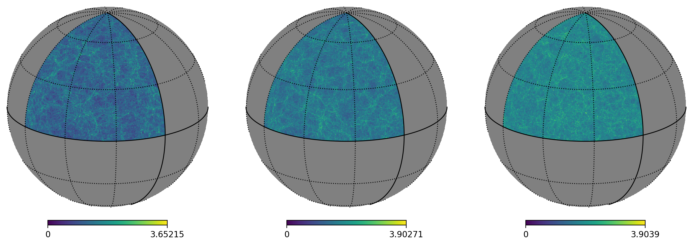

Pollux Documentation
====================

DESC package to create weak lensing and large-scale structure simulations from N-body simulations for the Higher-Order Statistics Topical Team.

Authors: Cyrille Doux and Juan Mena-Fernández

Features
--------

- Interfaces with HACC and SLICS N-body simulations
- Construction of particle and halo lightcones with replicated boxes and random isometries
- Lensing in the Born approximation with tomography support
- Generation of tomographic galaxy catalogs with multiple sampling methods
- Efficient parallel computation using `Parsl <https://parsl.readthedocs.io/>`_
- Integration with DESC tools: `CCL <https://github.com/LSSTDESC/CCL>`_, `healsparse <https://github.com/LSSTDESC/healsparse>`_, and `NaMaster <https://github.com/LSSTDESC/NaMaster>`_

.. toctree::
   :maxdepth: 2
   :caption: Documentation

   api
   changelog

Getting Started
---------------

For installation and tutorial notebooks, see the `GitHub repository <https://github.com/LSSTDESC/pollux>`_.

Indices and tables
==================

* :ref:`genindex`
* :ref:`modindex`
* :ref:`search`
