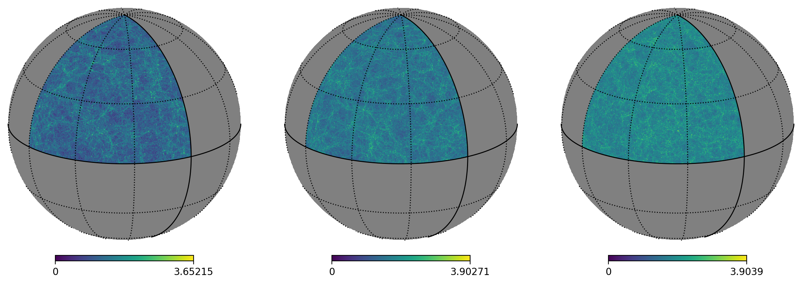

Pollux Documentation
====================

DESC package to create weak lensing and large-scale structure simulations from N-body simulations for the Higher-Order Statistics Topical Team.

Authors: Cyrille Doux and Juan Mena-Fernández

Features
--------

- Interfaces with `HACC <https://cosmology.alcf.anl.gov/>`_ and `SLICS <https://arxiv.org/abs/1805.04511>`_ N-body simulations.
- Construction of particle and halo lightcones with replicated boxes and random isometries (translations, rotations and flips), typically identical for groups of shells of width given by the box size, on the full sky or any footprint (optionally padded and apodized for harmonic transforms).
- Three ways of building the shells from particles: from the snapshot of each shell, replicated over the shell (:class:`~pollux.shells.SnapshotShellBuilder`), by slicing the lightcone outputs of the simulation (:class:`~pollux.shells.LightconeShellBuilder`), or by interpolating the particle trajectories between consecutive snapshots to where they cross the lightcone (:class:`~pollux.shells.SnapshotInterpShellBuilder`).
- Lensing in the Born approximation (:class:`~pollux.lensing.BornLensingBuilder`), including tomography from user-defined redshift distributions, with shear and tidal fields from spherical harmonics.
- Baryonification of the shells with `BaryonForge <https://github.com/DhayaaAnbajagane/BaryonForge>`_ (:class:`~pollux.baryons.BaryonifiedShellBuilder`), with the matching correction of the matter power spectrum.
- Generation of tomographic galaxy catalogs using uniform sampling (:class:`~pollux.catalog.CatalogUniform`) or clustered sampling via (linearly biased) sampling of the density field with Multinomial (:class:`~pollux.catalog.CatalogClusteredMultinomial`, fixed total number of galaxies) or Poisson (:class:`~pollux.catalog.CatalogClusteredPoisson`, fixed density) samplings, with an optional Gaussian smoothing of the density chosen per shell.
- Intrinsic alignments, reduced shear and observed shapes in the catalogs.
- Catalog statistics (Cls with NaMaster, 2pt functions with TreeCorr, including those of the intrinsic alignments) and theory predictions with CCL.
- Efficient parallel computation using the `Parsl <https://parsl.readthedocs.io/>`_ framework to distribute tasks over computing resources (:mod:`pollux.pipeline`), with a record of the code and environment of each run.
- Use of DESC tools: `CCL <https://github.com/LSSTDESC/CCL>`_, `healsparse <https://github.com/LSSTDESC/healsparse>`_ and `NaMaster <https://github.com/LSSTDESC/NaMaster>`_.

Papers
------

- `Mena-Fernández et al. (2026) <https://arxiv.org/abs/2605.00821>`_: optimization of weak lensing lightcone simulations for higher-order statistics in LSST, using lightcones created from HACC simulations with pollux.
- `Bera et al. (2026) <https://arxiv.org/abs/2605.00818>`_: impact of baryonic feedback on two- and three-point correlation functions of galaxies and shear, from these same lightcones baryonified.

Contents
--------

:doc:`getting_started` installs pollux and goes from a simulation to a catalog in a few lines. The next pages
describe each step and its options, :doc:`pipeline` runs them at scale, and :doc:`outputs` reads the products.

.. toctree::
   :maxdepth: 2
   :caption: User guide

   getting_started
   shells
   lensing
   baryons
   catalogs
   intrinsic_alignments
   statistics
   pipeline
   outputs
   notebooks

.. toctree::
   :maxdepth: 1
   :caption: Reference

   api
   changelog

Indices and tables
==================

* :ref:`genindex`
* :ref:`modindex`
* :ref:`search`
