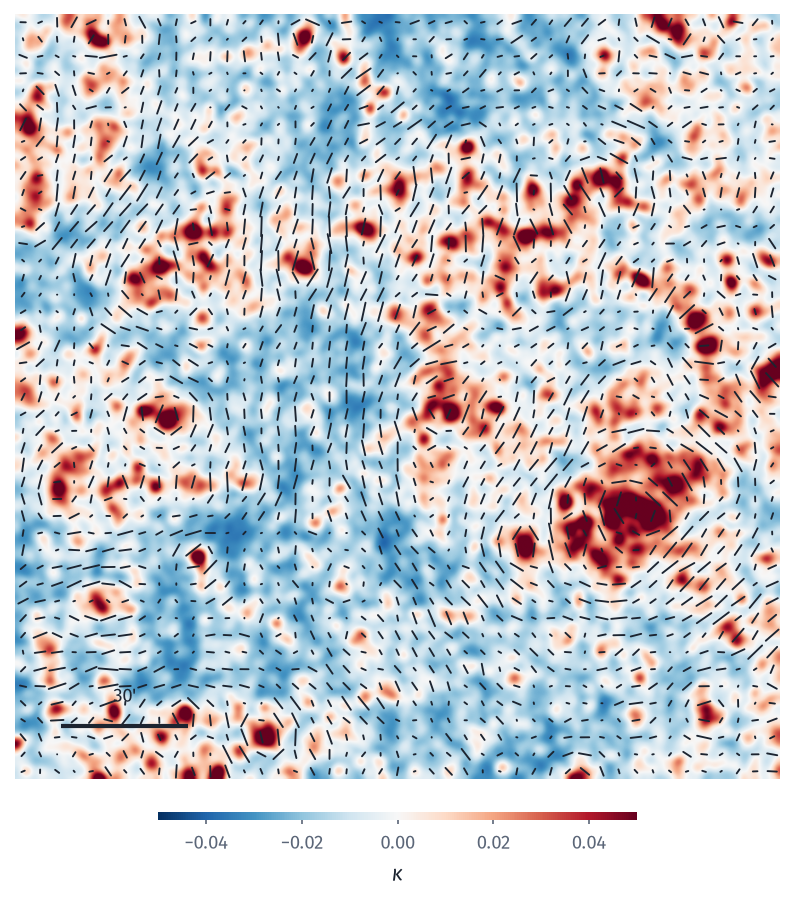

Lensing
=======

Lensing builders (:mod:`pollux.lensing`) make convergence maps by summing the density contrast of the shells with
lensing weights, in the Born approximation (:class:`~pollux.lensing.BornLensingBuilder`), then shear maps from
them.

   Convergence and shear of a source bin of HACC150_3 on 3 degrees.

Convergence
-----------

``nzs`` sets the sources:

- a list of redshift distributions, one per tomographic bin: ``(z, n(z))`` tuples or functions of ``z`` (they need
  not be normalized). The maps of bin ``i`` are ``kappa_bin{i}``, and ``tag`` names the set of distributions
  (outputs in ``kappa/{tag}/``);
- ``'snapshots'``: one source plane at the far edge of each shell, as made by
  :meth:`~pollux.shells.ShellBuilder.snapshot_lensing_builder` (:class:`~pollux.lensing.SnapshotBornLensingBuilder`,
  outputs in ``kappa/snapshots/``). Catalogs interpolate these maps between the shells around each galaxy.

The convergence of map :math:`j` is a weighted sum of the density contrasts :math:`\delta_i` of the shells. By
default (``multiple_planes=False``), the weight of a shell is the integral of the lensing kernel over it,

.. math::

    \kappa_j = \sum_i w_{ij}\, \delta_i, \qquad w_{ij} = \int_{\chi_i}^{\chi_{i+1}} q_j(\chi)\, d\chi,

with :math:`q_j` the lensing kernel of the n(z) of map :math:`j` (CCL). With ``multiple_planes=True``, each shell is a
thin lens plane at its mean redshift, whose surface density (particle mass over pixel area) is weighted by the
inverse critical surface density averaged over the sources behind it (see
:meth:`~pollux.lensing.BornLensingBuilder.compute_weight` for both). The mean density of each shell is that expected
from the simulation, or measured on its map with ``nbar_from_maps=True``.

``construct_maps`` builds the convergence maps.

Shear
-----

:meth:`~pollux.lensing.LensingBuilder.compute_shear_maps` derives the shear ``gamma1``, ``gamma2`` from the
spherical harmonics of the convergence, with the spin-2 factors of the full sky. With ``smooth_Mpc``, both are
smoothed by a Gaussian of that comoving scale.

Noise
-----

Convergence maps have no shape noise: their only noise is the particle shot noise of the shells, propagated
through the weights of the sum (:meth:`~pollux.lensing.BornLensingBuilder._noise_cls`), which sets the noise of
their predicted error bars. The noise of a survey belongs to catalogs (shape noise of the galaxies).
